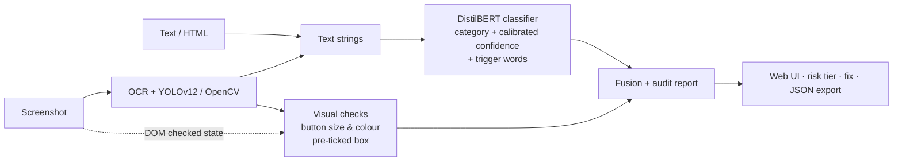

# cheeks_TechnovusS

# 🛡️ CheekShield AI

**A multimodal auditor for dark patterns and deceptive UI in e-commerce.**
Paste text, HTML or a screenshot. CheekShield flags manipulative design and shows the evidence for every finding: category, source text or UI region, confidence, risk level and a suggested fix.

*TECHNOVUS Hackathon · AAYAM XI · NIT Agartala · AI & ML track ·

> Outputs are assistive indications of potentially deceptive design, not legal findings.

---

## 1. The problem in one popup

> "Hurry! Only 2 left. Offer ends in 04:59" · ☑ pre-ticked "Add Rs 199 protection" · big **KEEP MY PLAN** vs tiny grey "No thanks, I prefer paying full price"

That single popup has four manipulations. Dark patterns live in three places:

| Where | Example | What catches it |
|---|---|---|
| **Words** | Fake urgency, scarcity, guilt-driven opt-outs | Text model |
| **Pixels** | Tiny grey "Cancel" beside a huge "Keep"; pre-ticked boxes | Vision and DOM checks |
| **Context** | "Only 2 left" is deceptive, "Ships in 2 business days" is not | A language model, not keywords |

A keyword filter fails on context. A text-only model cannot see layout. An object detector finds buttons but cannot tell whether they are deceptive. So we combined all three signals.

---

## 2. Our plan and why

We audited existing dark-pattern baselines before writing code and found three common flaws. Each one shaped a design decision.

| Flaw we found | Our decision | Reason |
|---|---|---|
| **Leaky evaluation.** Random splits put "Only 2 left" in train and "Only 3 left" in test. Even simple logistic regression scores close to RoBERTa-large, so headline accuracy flatters. | Digit-normalised de-duplication, **split by website** (70/15/15), hand-built hard negatives | The model is tested only on sites and phrasings it has never seen |
| **Text can't see pixels.** | OCR + YOLOv12 / OpenCV geometry + DOM `checked` state | Catches tricks that live in layout, not wording |
| **Overconfident black box.** | Temperature scaling + leave-one-out word evidence | "90% sure" should mean about 90% right, and users should see which words mattered |

**Design principles**

- **Core works on text alone.** Vision is an add-on, never a dependency.
- **Every finding is source-linked.** The original text or UI region is always shown.
- **Honest about limits.** "Likely concern" is kept separate from "verified wrongdoing".

---

## 3. System architecture




**Categories detected:** Urgency, Scarcity, Social Proof, Misdirection (confirmshaming and visual), Preselected Choice, Other Dark Pattern (sneaking, obstruction, forced action), and Not Dark Pattern, which gives a clear "clean interface" result.

| Category | Signal |
|---|---|
| Urgency, Scarcity, Social Proof | DistilBERT |
| Misdirection (wording) | DistilBERT |
| Misdirection (small grey cancel vs big coloured keep) | Detector boxes + size and colour check |
| Preselected choice | Checkbox detection + ticked check / DOM `checked` flag |

---

## 4. The deep learning network

### 4.1 Text model: DistilBERT with a new classification head

We use **transfer learning**. A language model that already understands English is reused, and only a small new head is trained for our labels.

```
Input text:  "[BUTTON] text [SEP] context"
   │
   ▼
Tokenizer + embeddings      up to 64 tokens → each token = 768 numbers      ┐
   │                                                                         │
   ▼                                                                         │ PRETRAINED
6 × Transformer block       self-attention (12 heads)                        │ (already speaks English)
                            → feed-forward 768 → 3072 → 768 (GELU)           │
   │                                                                         │
   ▼                                                                         ┘
Summary vector              first token = whole sentence (768 numbers)
   │
   ▼                                                                         ┐
Pre-classifier              768 → 768, ReLU, dropout 20%                     │ NEW (trained
   │                                                                         │ from scratch)
   ▼                                                                         │
Output layer                768 → 6 category scores                          ┘
   │
   ▼
Softmax → category + confidence   (then temperature-calibrated)
```


**How to read it**

- **Self-attention** lets every word look at every other word. This is how "Hurry" links to "Only 2 left" (urgency), while "2" links to "business days" (benign). It reads context, not keywords.
- **Pretrained layers** carry general language knowledge. **New layers** learn our six labels. Training mostly adjusts the head and gently nudges the rest.
- About **66M parameters**, almost all in the pretrained part.

**Why DistilBERT:** it is about 40% smaller and 60% faster than BERT while keeping most of its accuracy. UI strings are short, so a giant model adds little and costs more to run.

### 4.2 Vision model: YOLOv12 (finds parts, not lies)

YOLOv12 is a one-pass object detector. A 640×640 screenshot goes through a backbone (R-ELAN blocks + **area attention**), then a neck that mixes fine and coarse detail, and the detection heads return boxes for 5 UI classes: **button, checkbox, input field, popup, QR code**.

- **Area attention** splits the feature map into 4 strips, giving transformer-style context at CNN speed.
- **How we use it:** we fine-tune a *small* variant, which is realistic for a 12-hour build. The final layers are re-learned for the 5 classes. **OpenCV contour detection is the fallback.**
- **Limit:** it finds components, not deception. A "button" box alone means nothing, so detections are paired with OCR, geometry checks and the text model.


---

## 5. Training recipe: every setting has a reason

| Choice | Why |
|---|---|
| Split by website, 70/15/15 | One site repeats its templates, so a random split leaks |
| Digit normalisation + de-duplication | "Only 2 left" = "Only 5 left", which stops template memorising |
| Hard negatives + class weights | "Sale ends Sunday" teaches context, and rare classes get an equal say |
| Label smoothing 0.05 | Stops overconfidence on training labels |
| LR 3e-5, 10% warm-up, AdamW | The head starts random, and big steps would erase pretrained knowledge |
| Early stop on **macro-F1** | Accuracy hides rare classes, macro-F1 counts each equally |
| Temperature scaling | One number fitted on validation data so confidence is trustworthy |
| Baseline first (TF-IDF + logistic regression) | Shows what the transformer really adds |

Other settings: batch 16, up to 5 epochs (patience 2), gradient clipping 1.0, mixed precision on GPU.

---

## 6. Explainable findings

Each flagged item becomes an **audit card** with category, risk tier, original text or UI region, confidence, a one-line explanation, and a fix.

**Trigger words:** we remove each word in turn and measure how much the dark-pattern probability drops. Biggest drops are highlighted, e.g. `Hurry! −42%`, `Only −31%`. The percentages are illustrative.

**Visual checks (starting thresholds, tuned on our samples)**

1. **Button asymmetry:** the accept-to-decline area ratio is ≥ 1.45× or the colour-saturation gap is ≥ 45.
2. **Pre-ticked box:** find square contours (14–42 px), check for ink inside, read the DOM `checked` flag, and pair with the text beside it.
3. **Countdowns and claims:** OCR text with a time pattern goes to DistilBERT, which decides if the urgency is genuine or fake.

---

## 7. Evaluation

We report two scores side by side so the gap is visible:

1. **Unseen-website test set:** macro-F1, per-class precision/recall/F1, and a confusion matrix.
2. **Independent hard set:** 150–200 elements we labelled from real pages, including **false-positive traps** ("Ships within 2 days") and **false-negative traps** (double-negative opt-outs).

| Metric | Unseen-website test | Hard set |
|---|---|---|
| Macro-F1 | `TODO: from outputs/model/meta.json` | `TODO` |

The confusion matrix is in `outputs/model/meta.json` and the dashboard. Misclassified examples are in `outputs/model/test_errors.csv`.

**Known limitation:** a genuine low-stock message and fake scarcity can use identical wording. Without inventory data, text alone cannot tell them apart. We label these **"needs review"** instead of claiming certainty. The vision detector was trained on Korean sites, so we test it on Indian shopping screenshots, and it finds components only.

---

## 8. Run it

```bash
pip install torch transformers scikit-learn pandas matplotlib streamlit \
            opencv-python-headless easyocr beautifulsoup4 pillow ultralytics

python build_hard_dataset.py                       # optional: hard-mode and stress-test data
python train_darkpattern.py --data ec-darkpattern/dataset/dataset.tsv   # writes outputs/model/
streamlit run app.py                               # web UI + evaluation dashboard
```

**Demo flow:** (1) deceptive sample flags scarcity, urgency, confirmshaming, pre-ticked box and button asymmetry, (2) benign sample returns "no issue detected", (3) evaluation tab and JSON export.

**Inputs supported:** pasted text · HTML/DOM · screenshot (PNG/JPG). Sample inputs are in `samples/`.

---

## 9. Requirements checklist

| # | Requirement | Where |
|---|---|---|
| 1 | Input and end-to-end analysis | Text, HTML, screenshot |
| 2 | Genuine ML | Fine-tuned DistilBERT + YOLOv12 |
| 3 | 3+ categories | 6 text classes + 2 visual checks |
| 4 | Evidence-backed audit | Category, source, explanation, confidence, clean state |
| 5 | Responsive UI | Streamlit web app |
| 6 | Quantitative evaluation | Held-out set, confusion matrix, limitations |
| 7 | Runnable demo + README | This file |

---

## 10. Data, licences and external dependencies

| Item | Use | Note |
|---|---|---|
| [yamanalab/ec-darkpattern](https://github.com/yamanalab/ec-darkpattern) | Text training data | Apache-2.0 (verify before release) |
| [B4E2 DarkLens YOLO dataset](https://github.com/B4E2/B4E2-DarkLens-YOLO-DataSet) | UI component detection | Check licence on the Kaggle/Roboflow page |
| [arXiv 2512.18269](https://arxiv.org/abs/2512.18269) | YOLOv12 dark-pattern paper | Reference |
| Hugging Face `transformers` | Pretrained DistilBERT | Disclosed dependency |
| Ultralytics | YOLOv12 | Disclosed dependency |
| EasyOCR, OpenCV, BeautifulSoup | OCR, geometry, DOM parsing | Disclosed dependencies |

## 11. Next steps

Browser extension · multi-step checkout crawler · Indian-language support · active-learning feedback.

Useful for consumers, UX teams and compliance reviews.
References and licences 
- https://arxiv.org/abs/2211.06543
- https://github.com/yamanalab/ec-darkpattern/tree/master
- https://github.com/B4E2/B4E2-DarkLens-YOLO-DataSet
- https://arxiv.org/abs/2512.18269
